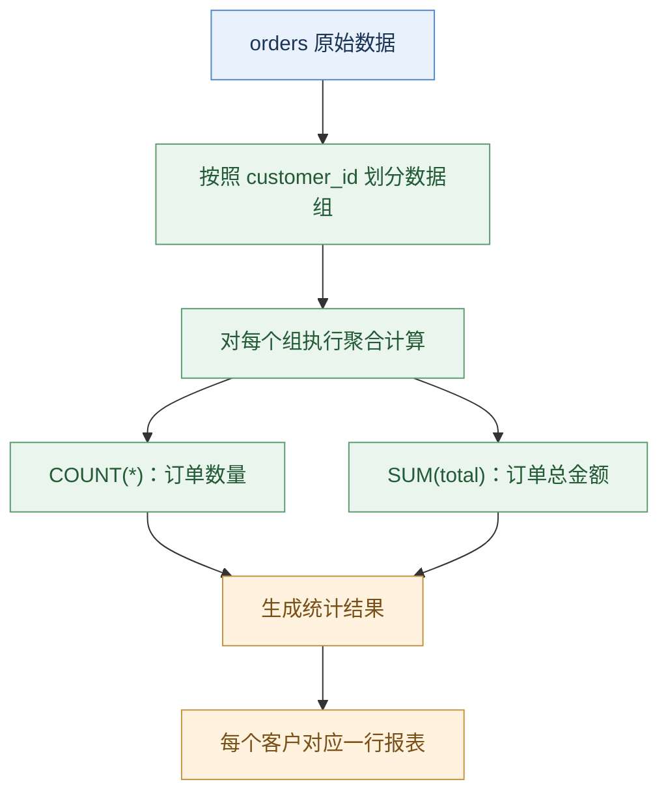
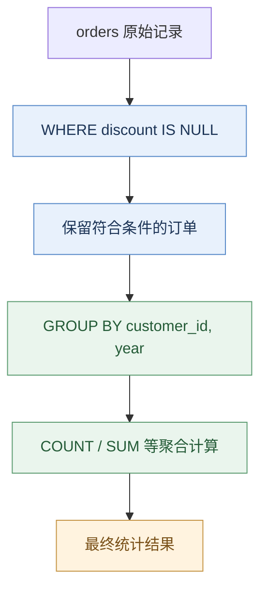

# Querying Data — Aggregating Data（数据聚合）

前面学习的 `SELECT` 主要用于查询表中的记录。本节开始学习另一种查询方式：**不再逐行返回数据，而是将多行数据汇总成统计结果。**

核心内容包括聚合函数（Aggregate Functions）、分组（`GROUP BY`），以及如何组合过滤条件和分组统计。

## 1. 聚合函数：对数据进行汇总

聚合函数（Aggregate Functions）用于对多行数据进行计算，最终返回统计结果，而不是逐行返回原始记录。

PostgreSQL 常用的聚合函数包括：

| 序号 | 聚合函数 | 功能说明                       |
| ---- | -------- | ------------------------------ |
| 1    | COUNT()  | 统计行数、字段非 NULL 值的数量 |
| 2    | SUM()    | 对数值类型字段求和             |
| 3    | AVG()    | 计算数值字段的算术平均值       |
| 4    | MIN()    | 返回字段中的最小值             |
| 5    | MAX()    | 返回字段中的最大值             |

---

### 1.1 `COUNT(*)` 与 `COUNT(column)`

`COUNT()` 有两种常见用法，它们的区别非常重要。

**（1）`COUNT(*)`：统计总行数**

```sql
SELECT COUNT(*)
FROM users;
```

返回 `users` 表中的总记录数。

这里的 `*` 与 `SELECT *` 中的含义不同：

- `SELECT *`：返回所有列。
- `COUNT(*)`：统计符合条件的所有行数。

PostgreSQL 对 `COUNT(*)` 有专门的优化，因此，如果目的是统计行数，直接使用它即可，不需要为了性能特意改成 `COUNT(id)`。

**（2）`COUNT(column)`：统计非 `NULL` 值的数量**

```sql
SELECT
    COUNT(id) AS id_count,
    COUNT(phone) AS phone_count
FROM users;
```

`COUNT(column)` 只统计指定列中非 `NULL` 的值。

例如，假设 `users` 表有以下数据：

| id   | phone  |
| ---- | ------ |
| 1    | 123456 |
| 2    | NULL   |
| 3    | 789012 |
| 4    | NULL   |

对应结果：

| 表达式         | 结果 | 原因                 |
| -------------- | ---- | -------------------- |
| `COUNT(*)`     | 4    | 统计全部行           |
| `COUNT(id)`    | 4    | `id` 都不是 `NULL`   |
| `COUNT(phone)` | 2    | 只统计有电话号码的行 |

由于主键不允许为 `NULL`，所以 `COUNT(id)` 与 `COUNT(*)` 在这个例子中结果相同。

**记忆要点：**

- 想知道有多少行：`COUNT(*)`。
- 想知道某列有多少个非空值：`COUNT(column)`。

---

### 1.2 其他聚合函数

假设 `orders` 表中存在 `total` 列，代表订单金额。

```sql
-- 计算所有订单金额之和
SELECT SUM(total)
FROM orders;

-- 计算平均订单金额
SELECT AVG(total)
FROM orders;

-- 获取最低订单金额
SELECT MIN(total)
FROM orders;

-- 获取最高订单金额
SELECT MAX(total)
FROM orders;
```

这里有一个与上一节 `NULL` 密切相关的知识点：

**聚合函数 `SUM()`、`AVG()`、`MIN()` 和 `MAX()` 会自动忽略 `NULL`。**

因此，通常不需要提前使用 `COALESCE()` 把这些列中的 `NULL` 替换成其他值，再进行聚合。

---

## 2. GROUP BY：按照指定条件分组统计

前面使用聚合函数时，都是**对整张表的数据进行汇总**。

例如：

```sql
SELECT COUNT(*)
FROM orders;
```

它只会返回一个数字，表示所有订单的数量。

但实际业务中，我们**经常需要更细粒度的统计**：

- 每个客户分别下了多少订单？
- 每个客户分别产生了多少销售额？
- 每个客户在不同年份分别下了多少订单？

这就需要使用 `GROUP BY`。

**`GROUP BY` 的作用是按照指定列的值，将记录划分成不同的组，然后对每个组分别执行聚合计算。**

例如，统计每个客户的订单数量：

```sql
SELECT COUNT(*)
FROM orders
GROUP BY customer_id;
```

这段 SQL 已经完成了分组统计，但有一个问题：**结果只有一组组数字，我们不知道每个数字对应哪个客户**。

因此，讲师特别强调：**使用 `GROUP BY` 时，通常应该同时在 `SELECT` 中显示分组字段。**

```sql
SELECT
    customer_id,
    COUNT(*) AS order_count,
    SUM(total) AS total_revenue
FROM orders
GROUP BY customer_id;
```

这样得到的结果就更像一份报表：

| customer_id | order_count | total_revenue |
| ----------- | ----------- | ------------- |
| 55          | 2           | 350.00        |
| 27          | 3           | 520.00        |
| 18          | 5           | 810.00        |

现在，每一行代表一个客户，聚合函数分别计算该客户的订单数量和订单总金额。

---

### 2.1 GROUP BY 的工作过程

可以把分组统计理解为以下过程：



需要注意的是：`GROUP BY` 不只是给结果排序，而是改变了查询结果的粒度。

原始数据是一行一笔订单；按照 `customer_id` 分组后，结果变成一行一个客户。

---

### 2.2 多列分组：GROUP BY + EXTRACT

`GROUP BY` 不仅可以按照一列分组，也可以**同时按照多个条件分组**。

例如，我们不仅想知道每个客户有多少订单，还想知道他们在不同年份分别下了多少订单。

首先，需要从 `created_at` 中提取年份。

PostgreSQL 提供了 `EXTRACT()` 函数：

```sql
SELECT
    EXTRACT(YEAR FROM created_at) AS year
FROM orders;
```

`EXTRACT(YEAR FROM created_at)` 用于提取日期时间中的年份部分。

接下来，将客户和年份同时作为分组条件：

```sql
SELECT
    customer_id,
    EXTRACT(YEAR FROM created_at) AS year,
    SUM(total) AS total_revenue,
    COUNT(*) AS order_count
FROM orders
GROUP BY
    customer_id,
    EXTRACT(YEAR FROM created_at);
```

现在分组的粒度就发生了变化：

- 同一个客户的订单会被放在一起；
- 同一个客户不同年份的订单会被进一步拆分；
- 每个客户每一年都会有独立的统计结果。

例如：

| customer_id | year | total_revenue | order_count |
| ----------- | ---- | ------------- | ----------- |
| 1           | 2023 | 300.00        | 3           |
| 1           | 2024 | 120.00        | 1           |
| 1           | 2025 | 250.00        | 2           |
| 2           | 2023 | 180.00        | 2           |

以上数据仅用于展示结果结构。

这里可以看到，`GROUP BY` 的每一项都会影响最终分组的粒度。

---

## 3. WHERE 与 GROUP BY 的组合

分组统计并不意味着必须统计整张表。我们仍然可以使用 `WHERE` 提前过滤记录。

例如，只统计 `discount` 为 `NULL` 的订单：

```sql
SELECT
    customer_id,
    EXTRACT(YEAR FROM created_at) AS year,
    SUM(total) AS total_revenue,
    COUNT(*) AS order_count
FROM orders
WHERE discount IS NULL
GROUP BY
    customer_id,
    EXTRACT(YEAR FROM created_at);
```

这里需要理解两个操作的先后关系：

1. `WHERE`：先从原始记录中筛选符合条件的订单。
2. `GROUP BY`：再将筛选后的订单按照客户和年份分组。
3. 聚合函数：分别计算每个组的统计结果。



这里的关键是：**`WHERE` 过滤的是参与分组的原始记录，而不是分组计算完成后的统计结果。**

---

## 4. GROUP BY 常见错误：字段必须分组或聚合

使用 `GROUP BY` 时，很容易遇到 PostgreSQL 的一个错误：

```sql
SELECT
    customer_id,
    total
FROM orders
GROUP BY customer_id;
```

PostgreSQL 会提示类似错误：

```text
column "orders.total" must appear in the GROUP BY clause
or be used in an aggregate function
```

理解这个错误，需要回到 `GROUP BY` 的工作方式。

假设一个客户有三笔订单：

| customer_id | total |
| ----------- | ----- |
| 1           | 100   |
| 1           | 200   |
| 1           | 300   |

当我们执行：

```sql
GROUP BY customer_id
```

PostgreSQL 需要将这三行合并成一行。但是，`customer_id` 都是 `1`，可以明确归为一组；`total` 却分别是 `100`、`200` 和 `300`。

那么问题来了：**合并之后，`total` 应该返回哪个值？**是 `100`、`200`，还是 `300`？

SQL 没有告诉 PostgreSQL 应该如何处理这个字段，因此它无法确定结果。

---

### 4.1 两种解决方式

PostgreSQL 在错误信息中实际上已经给出了两种解决方案。

**方式一：使用聚合函数**

如果我们的目的是计算该客户的订单总金额，就应该使用 `SUM()`：

```sql
SELECT
    customer_id,
    SUM(total) AS total_revenue
FROM orders
GROUP BY customer_id;
```

这样 PostgreSQL 就知道如何将同一组中的多个 `total` 合并成一个统计结果。

**方式二：将字段也加入 GROUP BY**

```sql
SELECT
    customer_id,
    total
FROM orders
GROUP BY
    customer_id,
    total;
```

此时，分组依据变成了 `customer_id` 和 `total` 的组合。

**但这会改变分组粒度**：不同金额会被划分到不同组中。因此，如果你的业务目标是统计每个客户的订单总额，就不应该为了消除错误而随意添加 `total` 到 `GROUP BY`。

**判断原则：**

当你在使用 `GROUP BY` 时，`SELECT` 中的普通字段必须能够确定每个分组应该返回什么结果。通常有两种处理方式：

- 如果字段代表分组维度，将它加入 `GROUP BY`。
- 如果字段代表需要计算的统计数据，将它放进合适的聚合函数。

---

## 本节重点回顾

| 知识点             | 核心内容                                          |
| ------------------ | ------------------------------------------------- |
| `COUNT(*)`         | 统计总行数                                        |
| `COUNT(column)`    | 统计指定列的非 `NULL` 值                          |
| `SUM()`            | 计算总和                                          |
| `AVG()`            | 计算平均值                                        |
| `MIN()` / `MAX()`  | 获取最小值 / 最大值                               |
| `GROUP BY`         | 按照指定条件划分数据组                            |
| `EXTRACT()`        | 从日期时间中提取指定部分                          |
| `WHERE + GROUP BY` | 先过滤原始记录，再进行分组统计                    |
| GROUP BY Error     | `SELECT` 中的普通字段必须参与分组，或使用聚合函数 |

**本节最重要的三个理解：**

1. 聚合函数将多行数据汇总成统计结果，`COUNT(*)` 和 `COUNT(column)` 的区别尤其需要掌握。
2. `GROUP BY` 决定统计的粒度。按客户分组是一种粒度，按客户和年份分组则是更细的粒度。
3. 使用 `GROUP BY` 时，要明确 `SELECT` 中每个字段应该如何处理，不能让 PostgreSQL 面对一组不同的值却不知道应该返回哪一个。

**与前面知识的联系：**

现在已经具备了构建基础数据报表的几个重要工具：

- `WHERE`：确定哪些原始记录参与统计。
- `GROUP BY`：确定按照什么维度划分数据。
- Aggregate Functions：确定每组需要计算什么指标。

这三个部分结合起来，就可以完成很多常见的数据库统计需求，例如订单数量、客户消费金额和年度销售统计。