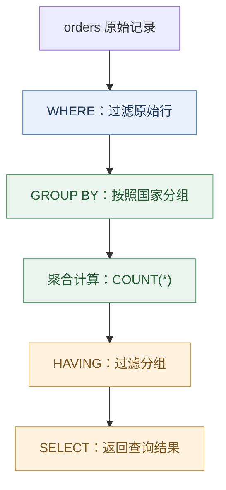

# Querying Data — HAVING（过滤分组结果）

上一节学习了 `GROUP BY`，知道如何将记录分组，再通过 `COUNT()`、`SUM()` 等聚合函数计算统计结果。

但实际查询中，我们往往还需要进一步筛选这些统计结果。

例如：

- 只显示订单数量达到 50 笔的国家；
- 只显示订单总金额超过指定金额的客户；
- 只显示满足某个统计条件的分组。

这就是 `HAVING` 的用途：**在分组和聚合之后，过滤不符合条件的分组。**

---

## 1. WHERE 与 HAVING：过滤对象不同

先看一个例子：统计每个国家收到的订单数量。

```sql
SELECT
    shipping_country,
    COUNT(*) AS order_count
FROM orders
GROUP BY shipping_country;
```

假设查询得到以下结果：

| shipping_country | order_count |
| ---------------- | ----------- |
| US               | 120         |
| CA               | 80          |
| UK               | 45          |
| AU               | 30          |
| DE               | 15          |

现在，我们只想显示订单数量达到 50 的国家。

一个容易想到的写法是：

```sql
SELECT
    shipping_country,
    COUNT(*) AS order_count
FROM orders
WHERE COUNT(*) >= 50
GROUP BY shipping_country;
```

但 PostgreSQL 会报错：

```text
aggregate functions are not allowed in WHERE
```

为什么？

因为 `WHERE` 和 `HAVING` 过滤的是不同阶段的数据：

- `WHERE`：过滤原始记录，也就是分组之前的行。
- `HAVING`：过滤已经完成分组和聚合的结果。

`COUNT(*)` 需要先知道每个分组包含多少行才能计算，因此不能直接放在 `WHERE` 中。

正确写法是使用 `HAVING`：

```sql
SELECT
    shipping_country,
    COUNT(*) AS order_count
FROM orders
GROUP BY shipping_country
HAVING COUNT(*) >= 50;
```

此时，最终结果只保留订单数量大于或等于 50 的国家。

---

### 1.1 理解查询处理流程

可以把整个过程理解为：



这里需要建立一个明确的认识：

| 子句       | 过滤对象           | 执行阶段 |
| ---------- | ------------------ | -------- |
| `WHERE`    | 原始记录（Rows）   | 分组之前 |
| `GROUP BY` | 将记录划分为不同组 | 分组阶段 |
| `HAVING`   | 分组结果（Groups） | 分组之后 |

**记忆方法：WHERE 决定哪些行参与统计，HAVING 决定哪些统计结果可以保留。**

---

## 2. PostgreSQL 的 HAVING 别名限制

在 `SELECT` 中，我们可以使用 `AS` 为聚合结果指定别名：

```sql
SELECT
    shipping_country,
    COUNT(*) AS order_count
FROM orders
GROUP BY shipping_country;
```

那么，能不能直接在 `HAVING` 中使用 `order_count`？

```sql
SELECT
    shipping_country,
    COUNT(*) AS order_count
FROM orders
GROUP BY shipping_country
HAVING order_count >= 50;
```

在 PostgreSQL 中，这种写法不被支持。

必须在 `HAVING` 中重新写出聚合表达式：

```sql
SELECT
    shipping_country,
    COUNT(*) AS order_count
FROM orders
GROUP BY shipping_country
HAVING COUNT(*) >= 50;
```

也就是说：

- `SELECT` 中可以使用 `AS order_count` 定义输出列别名。
- PostgreSQL 的 `HAVING` 中不能直接引用这个别名。
- 需要重复写出 `COUNT(*)`。

这是 PostgreSQL 与一些其他数据库（例如课程中提到的 MySQL、SQLite）在这一点上的差异。

---

## 本节重点回顾

| 知识点     | 核心内容                                                  |
| ---------- | --------------------------------------------------------- |
| `WHERE`    | 在分组前过滤原始记录                                      |
| `GROUP BY` | 按照指定条件划分数据组                                    |
| `HAVING`   | 在分组后过滤统计结果                                      |
| `COUNT(*)` | 统计每个分组中的记录数量                                  |
| Alias      | PostgreSQL 的 HAVING 不能直接使用 SELECT 中定义的聚合别名 |

**本节最重要的理解：**

`WHERE` 和 `HAVING` 看起来都在过滤数据，但它们的过滤对象不同：

- 想在统计之前排除某些订单，使用 `WHERE`。
- 想在统计之后排除不符合条件的客户或国家，使用 `HAVING`。

结合上一节，现在已经可以构建完整的分组统计查询：

```sql
SELECT
    shipping_country,
    COUNT(*) AS order_count
FROM orders
WHERE shipping_country IS NOT NULL
GROUP BY shipping_country
HAVING COUNT(*) >= 50;
```

这条查询依次完成：过滤原始记录、按照国家分组、统计订单数量、过滤订单数量不足 50 的分组。

**知识衔接：** `WHERE`、`GROUP BY`、聚合函数和 `HAVING` 是构建 SQL 统计报表的一组核心工具。理解它们各自负责的阶段，就能更容易地编写复杂的统计查询。