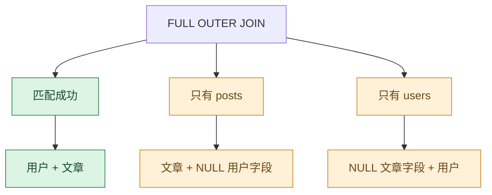

# Joining Tables — Right Joins

本节介绍三种相对少用的 JOIN：**RIGHT JOIN、FULL OUTER JOIN 和 CROSS JOIN**。重点不是记住所有 JOIN 的写法，而是理解它们分别保留哪些行，以及什么时候真正需要它们。

## 1. RIGHT JOIN：保留右表的所有记录

`RIGHT JOIN` 与 `LEFT JOIN` 的区别在于：**哪一张表的所有记录都会被保留。**

假设有两张表：

- `users`：用户表，每个用户有一个 `id`。
- `posts`：文章表，每篇文章通过 `user_id` 关联作者。

```sql
SELECT users.name, posts.title
FROM users
RIGHT JOIN posts ON users.id = posts.user_id;
```

这条查询以 `posts` 为右表，因此会：

- 返回所有文章，包括没有对应作者的文章（orphaned posts）。
- 如果文章存在对应用户，则同时返回用户信息。
- 如果文章没有对应用户，那么 `users.name` 为 `NULL`。

可以把 RIGHT JOIN 理解为：**右表的记录不能因为左表没有匹配项而被丢弃。**

---

### RIGHT JOIN 等价于 LEFT JOIN

RIGHT JOIN 并没有提供 LEFT JOIN 做不到的能力。只需要交换两张表的位置，就可以得到等价的查询：

```sql
-- RIGHT JOIN
SELECT users.name, posts.title
FROM users
RIGHT JOIN posts ON users.id = posts.user_id
ORDER BY posts.id ASC
LIMIT 10;

-- 等价的 LEFT JOIN
SELECT users.name, posts.title
FROM posts
LEFT JOIN users ON users.id = posts.user_id
ORDER BY posts.id ASC
LIMIT 10;
```

两条查询返回相同的结果：保留所有文章，并尽可能关联作者信息。

因此，课程作者更倾向于使用 LEFT JOIN：**通过调整 FROM 中表的顺序，让需要完整保留的表放在左边。**

这也是日常 SQL 开发中更常见、更容易阅读的写法。

---

## 2. FULL OUTER JOIN：保留两张表的所有记录

`FULL OUTER JOIN`（也可以简写为 `FULL JOIN`）同时保留左右两张表的所有记录。

```sql
SELECT users.name, posts.title
FROM posts
FULL OUTER JOIN users ON users.id = posts.user_id;
```

它的结果包含三种情况：

| 情况             | 查询结果                    |
| ---------------- | --------------------------- |
| 文章有对应用户   | 返回用户和文章信息          |
| 文章没有对应用户 | 保留文章，用户字段为 `NULL` |
| 用户没有发表文章 | 保留用户，文章字段为 `NULL` |

也就是说，FULL OUTER JOIN 把两张表的匹配记录和双方未匹配的记录全部放在同一个结果集中。

结果结构示意：



---

### 使用 NULL 找出未匹配记录

FULL OUTER JOIN 的一个实用场景是检查两张表中没有匹配关系的数据。

例如，只查询没有对应用户的文章，以及没有发表过文章的用户：

```sql
SELECT users.name, posts.title
FROM posts
FULL OUTER JOIN users ON users.id = posts.user_id
WHERE
    users.id IS NULL
    OR posts.id IS NULL
ORDER BY posts.id ASC;
```

这里利用了 JOIN 的一个重要行为：**当某一侧没有匹配记录时，该侧的列会被填充为 NULL。**

因此：

```sql
-- 找出没有对应用户的文章
WHERE users.id IS NULL

-- 找出没有发表文章的用户
WHERE posts.id IS NULL

-- 找出成功匹配的用户和文章
WHERE users.id IS NOT NULL
  AND posts.id IS NOT NULL
```

注意，判断 NULL 应使用 `IS NULL` 或 `IS NOT NULL`，不能使用 `= NULL` 或 `!= NULL`。

这里使用 `users.id` 和 `posts.id` 作为判断依据，是因为它们通常是主键，不会在真实记录中取 NULL。实际查询时，应选择能够可靠判断记录是否存在的非空字段。

课程作者认为，FULL OUTER JOIN 的结果有时会把三类不同的数据混在一起：

1. 没有作者的文章；
2. 没有发表文章的用户；
3. 正常关联的用户和文章。

**如果业务只关心其中一种情况，分别使用 LEFT JOIN、INNER JOIN 或针对未匹配数据的查询，通常会更加直接**。

不过，FULL OUTER JOIN 并不是没有实际用途。例如，在核对两份数据集、比较两个系统中的记录时，它就很有价值。

---

## 3. CROSS JOIN：笛卡尔积

`CROSS JOIN` 会将左表中的每一行与右表中的每一行组合起来。

假设：

- `users` 有 3 行；
- `posts` 有 4 行。

执行：

```sql
SELECT *
FROM users
CROSS JOIN posts;
```

最终会得到：

$$
3 \times 4 = 12 \text{ rows}
$$

它不会根据外键或其他条件寻找匹配项，而是生成所有可能的组合。

因此，如果两张表分别有 \(m\) 行和 \(n\) 行，CROSS JOIN 的结果就是：

$$
m \times n
$$

它可以用于需要生成所有组合的场景，例如组合不同产品与规格，但如果不小心使用，也可能产生非常庞大的结果集。

本节没有深入讲解 CROSS JOIN。

---

## 4. 总结：重点掌握 INNER JOIN 和 LEFT JOIN

这节课程的核心观点是：虽然 SQL 提供了多种 JOIN 类型，但日常开发中不需要平均投入精力去掌握它们。

| JOIN 类型         | 保留哪些记录                     | 核心特点                     |
| ----------------- | -------------------------------- | ---------------------------- |
| `INNER JOIN`      | 两张表中匹配成功的记录           | 只返回交集                   |
| `LEFT JOIN`       | 左表全部记录，以及右表匹配的记录 | 保留左表                     |
| `RIGHT JOIN`      | 右表全部记录，以及左表匹配的记录 | 保留右表，可改写为 LEFT JOIN |
| `FULL OUTER JOIN` | 两张表的全部记录                 | 匹配和未匹配记录全部保留     |
| `CROSS JOIN`      | 两张表所有可能的组合             | 产生笛卡尔积                 |

**学习重点：**

- `INNER JOIN`：只关心两张表成功关联的数据。
- `LEFT JOIN`：需要保留主查询表的全部记录，即使关联表中没有对应数据。
- `RIGHT JOIN`：了解即可，通常可以通过交换表的顺序改写成 LEFT JOIN。
- `FULL OUTER JOIN`：适合需要同时保留两张表未匹配记录的场景。
- `CROSS JOIN`：理解笛卡尔积的含义，知道它会产生所有组合。

课程作者最后强调，**INNER JOIN 和 LEFT JOIN 是 SQL 中最常用的两种 JOIN，也是应该优先熟练掌握的部分。**