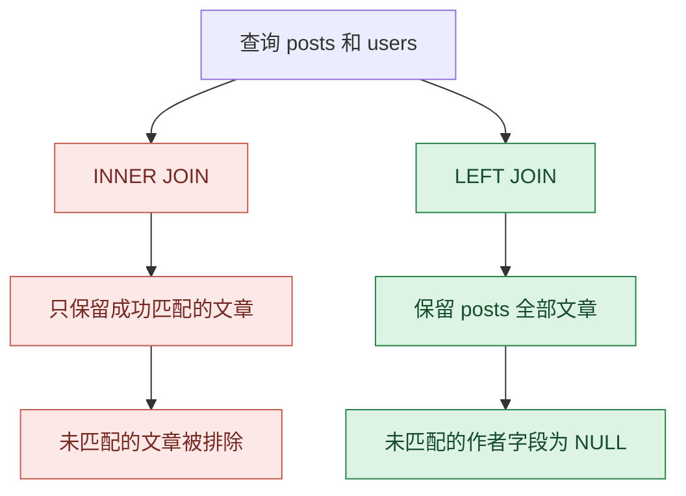
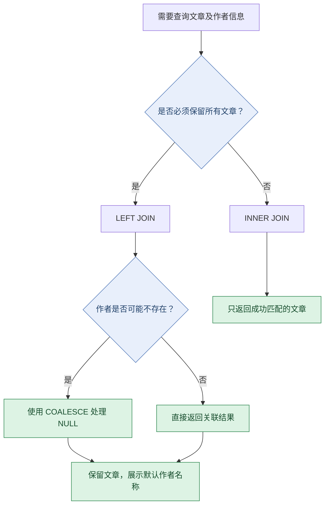

# Joining Tables — Orphaned Data

本节讨论 JOIN 查询中一个容易被忽略的问题：**INNER JOIN 可能导致原本有效的数据消失。**

问题不在于 INNER JOIN 写错了，**而在于它是否符合业务需求**。随着数据发生变化，原本正常的关联关系可能不再存在，因此需要谨慎选择 INNER JOIN 和 LEFT JOIN。

---

## 1. INNER JOIN 的潜在问题：数据可能消失

假设网站有两张表：

- `posts`：文章表，保存文章内容和作者 ID（`user_id`）。
- `users`：用户表，保存用户信息。

现在需要查询网站首页的文章，同时显示每篇文章的作者名称。

一个很自然的写法是：

```sql
SELECT
    posts.id AS post_id,
    posts.title,
    users.name
FROM posts
INNER JOIN users
    ON posts.user_id = users.id;
```

这条 SQL 可以正常工作，但它有一个容易被忽视的行为：**INNER JOIN 只返回两张表中能够成功匹配的记录。**

例如：

| posts.id | posts.title     | posts.user_id |
| -------- | --------------- | ------------- |
| 1        | PostgreSQL 入门 | 10            |
| 2        | 学习 SQL        | 20            |
| 3        | 数据库索引      | 30            |

| users.id | users.name |
| -------- | ---------- |
| 10       | Alice      |
| 20       | Bob        |

执行 INNER JOIN 后：

| post_id | title           | name  |
| ------- | --------------- | ----- |
| 1       | PostgreSQL 入门 | Alice |
| 2       | 学习 SQL        | Bob   |

第三篇文章没有找到对应的用户，因此不会出现在结果中。

这种存在于主表中，却无法在关联表中找到对应记录的数据，可以称为 **Orphaned Data（孤立数据）**。

---

### 为什么这可能成为问题？

课程作者举了一个实际开发场景：**用户可能因为 GDPR（通用数据保护条例）等原因要求删除自己的账户**。

假设某个用户删除了账户，但**他的文章仍然需要保留**：

- 文章本身仍然存在于 `posts`。
- 对应的用户记录已经不存在。
- 文章无法再关联到作者。

如果首页一直使用 INNER JOIN，那么这篇文章就会从查询结果中消失。

这意味着，**即使文章数据仍然存在，前端也可能突然无法显示它**。

需要注意，这种情况是否能够发生，还取决于数据库的外键约束和删除策略。例如，`ON DELETE CASCADE` 会级联删除关联文章，而 `ON DELETE SET NULL` 会保留文章并将作者 ID 设置为 NULL。

因此，选择 JOIN 时不能只考虑当前的数据，还应该考虑未来数据变化后的行为。

---

## 2. LEFT JOIN：保留所有文章

如果业务需求是：

> 无论作者是否存在，都必须显示所有文章；如果能找到作者，就显示作者名称。

那么应该使用 LEFT JOIN：

```sql
SELECT
    posts.id AS post_id,
    posts.title,
    users.name
FROM posts
LEFT JOIN users
    ON posts.user_id = users.id;
```

与 INNER JOIN 不同，LEFT JOIN 会保留左表（`posts`）中的全部记录。

即使某篇文章没有匹配到用户，对应的用户字段也会以 `NULL` 填充。

查询结果：

| post_id | title           | name  |
| ------- | --------------- | ----- |
| 1       | PostgreSQL 入门 | Alice |
| 2       | 学习 SQL        | Bob   |
| 3       | 数据库索引      | NULL  |

两种 JOIN 的核心差异：



---

## 3. COALESCE：处理关联结果中的 NULL

使用 LEFT JOIN 后，虽然不会丢失文章，但又出现了一个问题：作者名称可能是 NULL。

直接将 NULL 返回给前端，可能导致页面显示不友好。

课程作者选择在 SQL 查询中使用 `COALESCE` 处理这个问题：

```sql
SELECT
    posts.id AS post_id,
    posts.title,
    COALESCE(users.name, 'Unknown Author') AS author
FROM posts
LEFT JOIN users
    ON posts.user_id = users.id;
```

`COALESCE` 是 PostgreSQL 提供的函数，它会按照参数顺序返回第一个非 NULL 的值。

例如：

```sql
SELECT COALESCE(NULL, NULL, 'Unknown Author');
-- Unknown Author

SELECT COALESCE('Alice', 'Unknown Author');
-- Alice
```

因此：

- 如果 `users.name` 有值，就返回真实作者名称。
- 如果 `users.name` 是 NULL，就返回 `'Unknown Author'`。

最终结果：

| post_id | title           | author         |
| ------- | --------------- | -------------- |
| 1       | PostgreSQL 入门 | Alice          |
| 2       | 学习 SQL        | Bob            |
| 3       | 数据库索引      | Unknown Author |

这里的 `AS author` 是给查询结果中的字段设置别名，让前端可以直接使用统一的 `author` 字段。

**需要区分：COALESCE 只负责提供显示时的默认值，并没有修复数据库中的孤立数据。**

真正的孤立数据仍然存在。开发者还需要根据业务需求决定是否修复关联关系、保留文章，或者进一步处理用户删除后的数据。

NULL 也可以交给前端处理。课程作者个人更倾向于在后端 SQL 中完成这件事，但这属于实现方式的选择，而不是强制要求。

---

## 4. 总结：根据业务需求选择 JOIN

本节真正想强调的不是 INNER JOIN 不好，而是不要在没有明确业务需求的情况下习惯性地使用 INNER JOIN。

| 业务需求                         | 推荐方式               | 原因                       |
| -------------------------------- | ---------------------- | -------------------------- |
| 只显示有作者的文章               | `INNER JOIN`           | 只返回完整匹配的数据       |
| 显示所有文章，作者信息尽可能提供 | `LEFT JOIN`            | 不会因为缺少作者而丢失文章 |
| 作者不存在时显示默认名称         | `LEFT JOIN + COALESCE` | 保留文章，同时处理 NULL    |

可以记住这条判断逻辑：



**核心 takeaway：**

1. `INNER JOIN` 会排除没有匹配记录的数据，但这不代表它有问题，关键是业务是否允许这种数据被排除。
2. `LEFT JOIN` 可以保证左表记录完整保留，适用于即使关联数据不存在，也不能丢失主数据的场景。
3. `COALESCE` 可以将 NULL 替换为合理的默认值，改善查询结果的可用性。
4. 数据会随着业务发展发生变化。设计查询时，不仅要考虑当前数据，还要考虑关联记录被删除、修改或缺失时，查询结果应该如何表现。

**本节最重要的开发习惯：写 JOIN 之前，先明确哪些记录必须保留，而不是先决定使用哪一种 JOIN。**