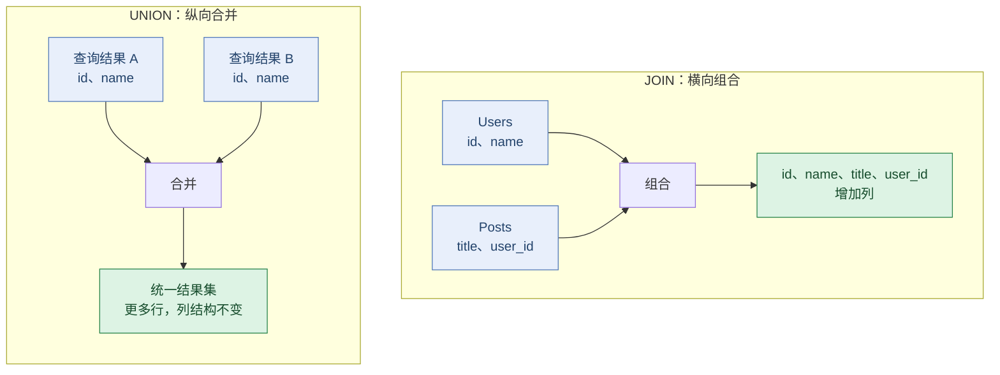

# Joining Tables — UNION 与 UNION ALL

前面学习的 JOIN 是将两张表的数据**横向组合**，把不同表的列放到同一行中。

本节介绍另一种组合数据的方式：**UNION 将多个查询结果纵向合并，把不同结果集的行堆叠在一起。**

## 1. JOIN 与 UNION：横向组合和纵向合并

两者最大的区别在于数据组合的方向：

- **JOIN**：横向组合，增加结果集的列，将不同表的数据关联到同一行。
- **UNION**：纵向合并，增加结果集的行，将多个查询结果堆叠在一起。



例如，两张表分别有 3 行数据：

- JOIN 关注如何将它们组合成更宽的行。
- UNION 则将它们上下堆叠，得到 6 行数据（假设没有去重）。

---

## 2. UNION：合并多个查询结果

课程使用了一个员工管理系统作为例子。

假设数据库中有两张表：

- `current_employees`：当前在职员工。
- `former_employees`：已经离职的员工。

**将员工分成两张表是一种设计选择**。例如，当历史数据非常庞大，而日常操作主要集中在当前员工时，可以考虑将当前数据和归档（Archive）数据分开管理。

**这样可以让日常业务主要操作较小的工作数据集，同时保留历史数据供查询**。

不过，拆分表并不意味着一定能提升性能，还需要结合数据规模、索引、查询模式等因素判断。

现在有一个需求：**查询所有员工的姓名和邮箱，无论员工目前是否在职**。

可以使用 UNION：

```sql
SELECT name, email
FROM current_employees

UNION

SELECT name, email
FROM former_employees;
```

这条查询会将两个 SELECT 的结果纵向合并，得到统一的员工列表。

假设：

- 当前员工有 25 人；
- 离职员工有 15 人。

最终得到 40 行（这里假设两组数据没有完全重复的行）。

**UNION 不要求两个查询来自不同的表，也可以合并同一张表上执行的不同查询结果。**

---

### UNION 的两个基本规则

使用 UNION 时，需要满足两个条件：**规则一：两个查询必须返回相同数量的列。**

例如：

```sql
-- 错误：第一个查询有三列，第二个查询只有两列
SELECT id, name, email
FROM current_employees

UNION

SELECT name, email
FROM former_employees;
```

PostgreSQL 无法直接将两个列数不同的结果集进行合并。

**规则二：对应位置的列必须具有兼容的数据类型。**

例如：

```sql
-- 错误：第一个查询的第一列是整数，
-- 第二个查询的第一列是字符串
SELECT id, name, email
FROM current_employees

UNION

SELECT 'foobar', name, email
FROM former_employees;
```

这里虽然两个查询都返回三列，但第一列的数据类型不兼容。

需要注意，PostgreSQL 实际要求的是对应列能够解析为兼容的共同数据类型，并不要求底层类型名称必须完全相同。例如，某些数值类型之间可以进行类型转换。

另外，UNION 是按照**列的位置**匹配的，而不是按照列名匹配的。因此，两个查询中的第一列会组合在一起，第二列也会组合在一起，以此类推。

---

### 使用字面量补充列和标记数据来源

除了合并数据，我们还可以在 SELECT 中使用字符串字面量，为结果增加额外的信息。

例如，**希望查询结果能够区分当前员工和离职员工**：

```sql
SELECT
    id,
    name,
    email,
    'current' AS type
FROM current_employees

UNION

SELECT
    id,
    name,
    email,
    'former'
FROM former_employees;
```

这里增加了一个 `type` 字段：

| id   | name    | email               | type    |
| ---- | ------- | ------------------- | ------- |
| 1    | Alice   | alice@example.com   | current |
| 2    | Bob     | bob@example.com     | current |
| 3    | Charlie | charlie@example.com | former  |

其中：

- `'current'` 和 `'former'` 是字符串字面量。
- `AS type` 为第四列设置名称。
- 第二个 SELECT 不需要重新声明别名，因为最终结果集的列名由第一个 SELECT 决定。

这种方式很实用：**在合并不同来源的数据时，可以使用额外字段标记每条记录的来源或类别。**

---

## 3. UNION 与 UNION ALL：是否需要去重？

这是本节另一个重要知识点。

`UNION` 默认会自动去重，而 `UNION ALL` 会保留所有记录，包括重复记录。

例如：

```sql
-- UNION：自动去重
SELECT 1
UNION
SELECT 1
UNION
SELECT 2;

-- 结果
-- 1
-- 2
```

即使多个查询都返回了 `1`，最终结果也只保留一条。

这是因为 UNION 会检查**整行数据**是否重复，而不是只比较某一个字段。

如果需要保留重复记录：

```sql
-- UNION ALL：不进行去重
SELECT 1
UNION ALL
SELECT 1
UNION ALL
SELECT 2;

-- 结果
-- 1
-- 1
-- 2
```

两者的区别：

| 对比       | UNION | UNION ALL |
| ---------- | ----- | --------- |
| 合并结果   | 是    | 是        |
| 自动去重   | 是    | 否        |
| 保留重复行 | 否    | 是        |
| 去重开销   | 有    | 无        |

---

### 为什么 UNION ALL 通常更快？

因为 `UNION` 必须检查合并结果中是否存在重复行，因此需要额外的去重操作。

而 `UNION ALL` 不需要执行这一步，可以直接保留并返回所有查询结果。

因此：

- 确定不需要去重时，优先使用 `UNION ALL`。
- 业务要求消除重复记录时，使用 `UNION`。

对于大型结果集，去重操作可能带来明显的额外开销。

---

## 4. 总结

| 特性         | JOIN                         | UNION                  |
| ------------ | ---------------------------- | ---------------------- |
| 组合方向     | 横向                         | 纵向                   |
| 主要变化     | 增加列                       | 增加行                 |
| 数据组合方式 | 根据关联条件组合记录         | 合并多个查询结果       |
| 结构要求     | 根据 JOIN 类型和查询字段决定 | 列数相同、对应类型兼容 |

UNION 相关知识：

| 语法        | 行为                       |
| ----------- | -------------------------- |
| `UNION`     | 合并结果，并自动去除重复行 |
| `UNION ALL` | 合并结果，保留所有行       |

**本节需要掌握的核心内容：**

1. JOIN 和 UNION 的区别：JOIN 横向组合数据，UNION 纵向合并数据。
2. UNION 的两个基本要求：查询结果列数相同，对应位置的列类型兼容。
3. 可以使用字符串字面量为结果增加标记字段，区分不同来源的数据。
4. UNION 默认根据整行数据去重，而 UNION ALL 保留重复记录。
5. 不需要去重时，优先考虑 UNION ALL，避免不必要的去重开销。

还有一个容易忽略的细节：**UNION 和 UNION ALL 都不保证结果的返回顺序。** 如果需要按照某个字段排序，应在整个 UNION 查询的末尾使用 `ORDER BY`。